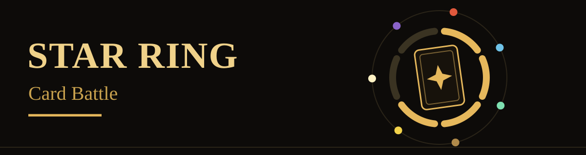
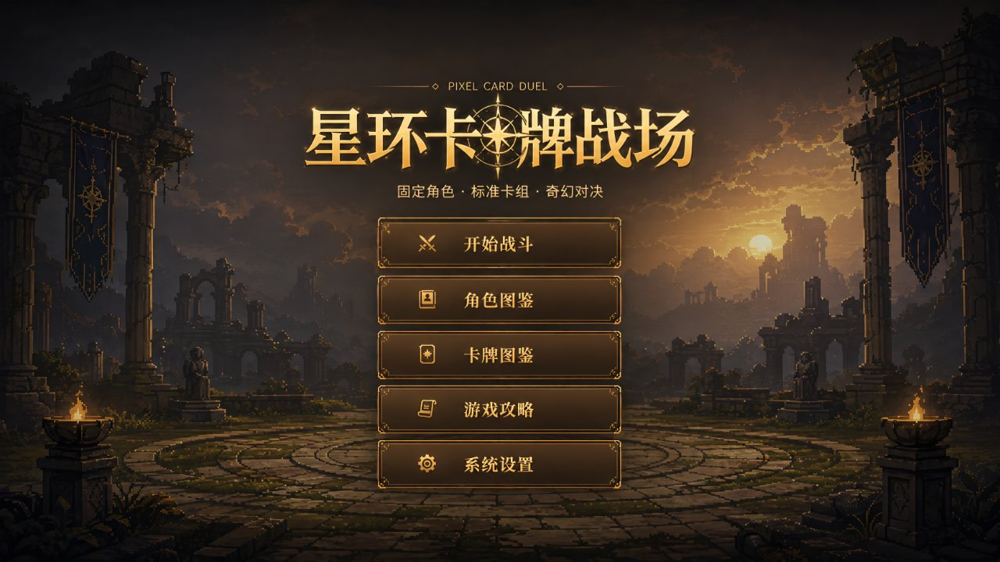
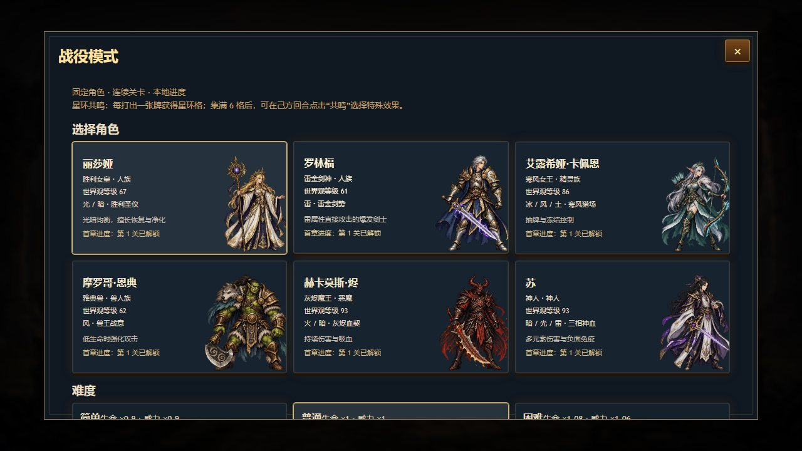

<p align="center">
  
</p>

A dark-gold fantasy card battler for the browser and Android. Pick one of six fixed champions, build turns around a 30-card deck and seven elements, and charge the Star Ring to unleash Resonance.

**[Play in your browser](https://seiya058904.github.io/star-ring-card-battle/)** · [Android release](https://github.com/seiya058904/star-ring-card-battle/releases/tag/v1.2.9) · [Game modes](#game-modes) · [Champions](#champions) · [Development](#development)

[](https://github.com/seiya058904/star-ring-card-battle/actions/workflows/verify.yml)

The game interface is in Chinese; this README is in English. Illustration above: the Star Ring and element systems, not a screenshot.



*The main menu of the live web build, captured at 1280×720 from a fresh browser profile.*

## Game Modes

Start Battle opens a choice between two modes.

- **Campaign.** Choose one of six fixed champions and fight a five-stage route of escalating enemies on Easy, Normal, or Hard. Winning a stage unlocks the next one for that champion, and recent results and grades are recorded locally. The difficulty screen lists the scaling: Easy is ×0.9 health and ×0.9 power, Normal ×1 and ×1, and Hard ×1.08 and ×1.06.
- **Sandbox.** A standalone battle space for freely choosing, generating, and testing decks without clearing the campaign first.

Inside a duel:

- **Play the hand.** Spend energy, pick your moment, and manage card costs, draws, shields, healing, and damage. Each fixed campaign champion fights with a 30-card deck.
- **Seven elements.** Fire, Ice, Wind, Earth, Thunder, Light, and Dark shape each champion's identity, card effects, and visual trails.
- **Star Ring Resonance.** Every card you play charges one segment of the ring. When all six are full, activate Resonance on your turn to choose a special effect.
- **More than raw damage.** Status effects, summons, passives, and enemy intent all matter, and a combat log keeps the outcomes readable.

## Champions

Each campaign champion has an elemental affinity, a passive ability, and a fixed deck. The names below are Latin-letter transliterations for this README; in-game names are unchanged.



| Champion | Race | Elements | Style |
| --- | --- | --- | --- |
| Lishaya | Human | Light, Dark | Healing, cleansing, and defensive recovery |
| Luolinfu | Human | Thunder | Explosive lightning-infused sword attacks |
| Eluxiya Kapeien | Elf | Ice, Wind, Earth | Card draw, freezing, and ranged control |
| Moluoge Endian | Orc | Wind | Attacks grow stronger as health falls |
| Hekamos Jin | Demon | Fire, Dark | Damage over time, dark magic, and lifesteal |
| Su | Divine | Dark, Light, Thunder | Broad multi-element damage and resistance to negative effects |

## Campaign

The first route is five authored encounters, from an opening shadow trial to a final dragon-god battle: **Shadow Trial, Frozen Arrows, Flame Ox Front, Ruin Dragon King, Ancestral Dragon God** (English renderings of the Chinese stage names). Campaign progress is stored in your browser, not in a cloud account.

The presentation pairs pixel-fantasy art with engraved card frames and element-specific attack effects. Desktop, narrow, and short-screen layouts keep real card hit areas and essential controls, and playback settings and `prefers-reduced-motion` adjust motion without removing information needed to play.

## Play and Download

- **Web:** play at <https://seiya058904.github.io/star-ring-card-battle/>. Its logic, UI, and assets run entirely in the browser with no backend.
- **Android:** the [v1.2.9 release](https://github.com/seiya058904/star-ring-card-battle/releases/tag/v1.2.9) provides `star-ring-card-battle-v1.2.9.apk` and `SHA256SUMS.txt`. It is an offline Kotlin/WebView shell with synchronized local assets, built with the project's Debug signing workflow rather than a separate production-signing system.

To run the web source locally, start any static server from the repository root and open the page:

```powershell
python -m http.server 8000
```

Open <http://127.0.0.1:8000/>. The web game is plain HTML, CSS, and JavaScript, so there is no npm build step.

> [!NOTE]
> Progress is local to the browser. Campaign records use `localStorage`, so clearing site data or changing browsers or origins can make it unavailable. The web and Android editions share game resources but not saves.

## Development

The root web files are authoritative. The Android `app/src/main/assets/www/` directory is a generated offline mirror, so change the root files and resynchronize instead of editing it by hand.

| Path | Responsibility |
| --- | --- |
| [`index.html`](index.html) | Browser entry and core runtime assembly |
| [`js/fixed-card-library.js`](js/fixed-card-library.js) | Fixed champion decks and card effects |
| [`js/fixed-game-rules.js`](js/fixed-game-rules.js), [`js/battle-rules.js`](js/battle-rules.js) | Combat rules, turns, statuses, and damage |
| [`js/campaign-data.js`](js/campaign-data.js), [`js/campaign-ui.js`](js/campaign-ui.js) | Champions, the five-stage campaign, and progression UI |
| [`assets/`](assets/) | Characters, cards, sounds, icons, and battle artwork |
| [`android/`](android/) | Kotlin/Gradle WebView shell and the offline web mirror |
| [`docs/BATTLE_PRESENTATION.md`](docs/BATTLE_PRESENTATION.md) | Visual direction and presentation acceptance notes |

From the repository root, run the consolidated regression checks for combat, campaign behavior, presentation boundaries, storage, and web/Android asset parity:

```powershell
node scripts/verify-all.mjs
```

Check input and responsive behavior in a real browser when those areas change. After an authorized change to the web assets, resync and verify the Android mirror:

```powershell
node scripts/sync-android-web-assets.mjs
node scripts/verify-android-web-assets.mjs
```

An Android build needs JDK 17 and a configured Android SDK:

```powershell
.\android\gradlew.bat -p android assembleDebug --no-daemon
```

The Android configuration uses `versionName 1.2.9` and `versionCode 14`. Do not change signing, republish historical tags, or replace the release APK without an explicit release task. See [`AGENTS.md`](AGENTS.md) for source ownership and validation rules, and [`DESIGN.md`](DESIGN.md) for the presentation system.

## Status and Rights

Star Ring Card Battle is a playable experimental project, not a claim of a complete commercial release. The repository declares no project-wide open-source license. Third-party graphics and audio have their own provenance and permissions; the [audio notice](AUDIO-LICENSES.md) documents the procedural sound system and the CC0-licensed fallback sounds.
